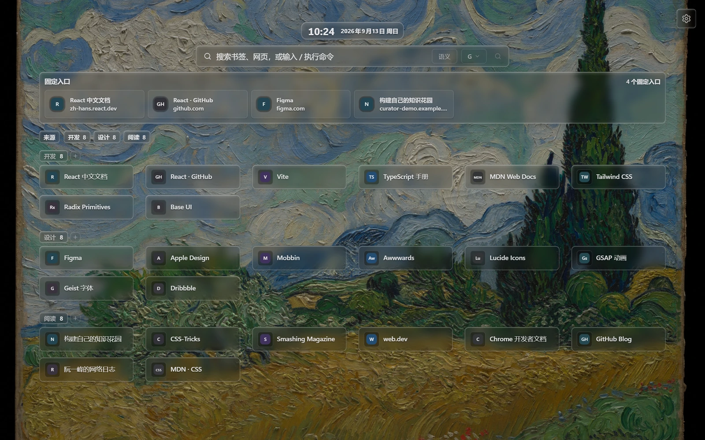

<p align="center">
  
</p>

<h1 align="center">Curator</h1>

<p align="center">
  <strong>找回、整理和使用你的书签</strong><br>
  本地优先的 Chrome 书签工作区：快速收藏与毫秒检索、常驻侧栏、液态玻璃新标签页、安全体检与 MHTML 离线存档。
</p>

<p align="center">
  
  
  
  
</p>

<p align="center">
  🔒 <strong>零账号体系 · 默认离线无遥测 · 直接读写原生书签无锁定 · 核心功能不依赖任何 AI 服务</strong><br>
  <sub>当前为公开 Beta 测试阶段，支持通过开发者模式加载安装，尚未在 Chrome Web Store 上架。</sub>
</p>

---

https://github.com/user-attachments/assets/54babc20-983f-42e3-bfc9-89510a9194aa

<p align="center">
  <sub>🎬 60 秒完整功能演示 · 1080p / 30fps · 画面来自当前版本，使用演示书签与示例数据</sub>
</p>

## 为什么选择 Curator？

多数书签管理工具的问题在于：**收藏容易整理难、想找的时候搜不到、清理死链怕误删，或者把用户数据绑死在私有云端**。

Curator 专为高频浏览与知识积累设计，坚持**本地优先（Local-first）**原则：

- **原生同源，零数据锁定**：直接操作 Chrome 原生书签树。弹窗、侧栏和新标签页与浏览器实时双向同步；随时可以停用或卸载，所有书签完好无损。
- **随手收录，毫秒找回**：浏览时快捷键一键扔进 Inbox（待整理）；支持关键词、拼音首字母/全拼、路径、正文索引多维组合检索，告别“收藏即吃灰”。
- **常驻侧栏，不打断心流**：查资料、写文档时侧栏随手常驻，自动感知当前网页并就地归类，配合全键盘操作让效率倍增。
- **体检与恢复，清理不怕误删**：失效链接、重定向、重复项一键诊断；批量操作前自动创建快照恢复点，并提供独立回收站，随时可撤销。
- **液态玻璃新标签页**：基于物理着色器的实时折射与模糊美学，搭配 Speed Dial（固定入口）与多目录聚合，开箱即是清爽专注的工作台。
- **离线快照，永不 404**：原生捕获单文件 MHTML 离线存档，珍贵资料即便原站下线也能完整阅读。
- **自主可控，AI 纯属自选**：无需外部服务器，元数据全在本地；如需 AI 归类与摘要，可直接接入自己的 API Key 或本地模型，绝不强制。

---

## 核心功能全景

Curator 直接读写原生 Chrome 书签，弹窗、侧栏与新标签页共享同一份书签数据，收藏、改名、移动和删除会随浏览器书签事件即时更新。

| 你的需求场景 | 对应模块 | Curator 的实际实现 |
| --- | --- | --- |
| **先收藏，稍后再理** | 弹窗 / 侧栏 / 快捷键 | 当前页快捷保存、就地选目录，或按 `Alt + Shift + I` 直存 Inbox（待整理） |
| **快速找回历史资料** | 本地搜索引擎 | 关键词、拼音（首字母/全拼）、原文短语、域名、路径与时间组合检索；支持标签与正文索引 |
| **边阅读边整理** | 常驻书签侧栏 | 基于原生 Side Panel API，当前网页卡片实时联动、就地编辑与移动、全键盘流操作 |
| **打开浏览器即进入状态** | 液态玻璃新标签页 | 多文件夹聚合展示、Speed Dial（固定入口）、多引擎搜索、时钟与 13 种质感着色器/滤镜 |
| **清理年久失修的书签** | 设置 · 可用性管理与清理 | 可用性检测、重定向一键更新、严格安全去重、AI 归档建议、独立回收站与自动恢复点 |
| **防止网页失效或数据迁移** | 离线存档与备份 | 单文件 MHTML 完整离线存档、全量 JSON 备份（含设置与标签）、通用 HTML 书签导出 |

### 1. 随手收录与瞬时搜索

- **Inbox 收集箱**：在任意网页按下 <kbd>Alt</kbd> + <kbd>Shift</kbd> + <kbd>I</kbd>，直接将当前页收录到 **Inbox / 待整理**，不打断当前阅读；之后在“设置 → 待整理”集中归类。待办永久保留，已完成历史保留最近 200 条。
- **全能就地操作**：弹窗与侧栏中集成了目录树浏览、搜索结果与当前页状态，支持直接改名、换目录、删除、按 <kbd>F2</kbd> 编辑或键盘回车打开。
- **多维组合搜索**：支持标题、URL、文件夹路径与拼音（首字母/全拼）检索；配合标签、摘要和网页正文索引深度找回。本地搜索完全离线，无需联网或配置 AI。

### 2. 常驻书签侧栏

在弹窗顶部点击 **打开常驻书签侧栏**，即可将书签面板固定在浏览器右侧（基于 Chrome 原生 Side Panel API）：

- **当前页面状态联动**：侧栏会跟随当前标签页自动展示其是否已收藏、所在目录及操作卡片。
- **搜索状态持久保留**：打开书签、切换标签页或进入设置后，侧栏中的搜索关键词与筛选结果均不会丢失。
- **紧凑窄屏布局**：针对窄侧栏优化为纵向分层结构，文件夹树、结果列表与操作按钮自适应排列，支持按 <kbd>Ctrl</kbd>/<kbd>⌘</kbd> + <kbd>F</kbd> 即时筛选文件夹。

> **提示**：侧栏不会默认索取所有站点的访问权限。切换到未授权站点时，点击浏览器工具栏中的 Curator 图标即可为该页授权快速保存与智能分析；侧栏自身已有的书签检索和整理始终可用。

### 3. 液态玻璃新标签页

Curator 为日常高频使用的新标签页提供了兼具秩序感与现代美感的工作台，设置抽屉包含五个清晰分类：

- **来源 (Source)**：支持跨文件夹勾选多个来源，可自由切换平铺展开或分目录导航；支持隐藏目录标题，并可通过拖拽调整书签与文件夹顺序。
- **外观 (Appearance)**：
  - **背景设置**：支持纯色、本地壁纸图片、本地动态视频、在线图片直链以及精选艺术图库（NASA、大都会博物馆、Wikimedia、克利夫兰艺术博物馆等）。
  - **遮罩与着色器滤镜**：提供基础遮罩（深色渐变、磨砂玻璃、胶片噪点、柔光渐变）与 9 种艺术着色器/滤镜（胶片颗粒、单色网点、ASCII 字符、纸张纹理、条纹玻璃、水面折射、图像抖动、彩色网点、CMYK 网点），支持调节浓度、模糊、滤镜强度与网格大小。
  - **卡片与图标**：提供紧凑（148px / 28px）、均衡（184px / 32px）和展示（224px / 36px）三种预设；可细调页面边距、卡片宽度、列数、间距、图标尺寸及标题行数，支持上传自定义站点图标。
  - **时间与日期**：支持时间和日期、仅时间、仅日期三种模式；支持固定时区（北京、东京、伦敦、纽约等）、多种日期格式、显示秒数、12/24 小时制、3 种布局密度（单行/胶囊/卡片）与字号缩放。
- **玻璃 (Glass)**：
  - **液态玻璃材质引擎**：统一微调卡片、时钟、搜索栏与面板的模糊、底色浓度、斜角、厚度、折射、色散、边缘高光与光照角度，支持实时效果预览。
  - **材质预设与缓存**：内置均衡（默认）、清透（更透背景）、柔和（弱化折射）三种预设，支持一键撤销本次材质调整；首屏优先复用本地折射纹理缓存，秒开不卡顿。
- **搜索 (Search)**：
  - **多引擎集成**：内置本地书签检索与可选网页搜索（Google、Bing、百度、DuckDuckGo、Perplexity、ChatGPT、You.com、Kagi、Brave 等），支持多引擎并行检索与顺序配置。
  - **安全隔离**：新标签页的搜索引擎设置仅在当前面板生效，绝不修改 Chrome 全局默认搜索引擎。
  - **外观微调**：支持自定义占位符文本、宽度、高度、上下位置偏移以及自动垂直居中开关。
- **高级设置 (Advanced)**：
  - 支持“隐藏设置图标”（开启后悬停右上角渐显）、“点击书签在新标签页打开”，以及开启“固定入口（Speed Dial）”常用快捷书签面板。

<p align="center">
  
</p>

### 4. 智能体检、安全清理与数据恢复

#### 清理前先看明细，不盲目误删
- **可用性管理体系**：在“设置 → 书签管理 → 可用性管理”中提供完整的体检流程：
  1. **书签可用性检测**：精准标记可访问、已重定向、待复查与访问失败，并支持查看检测进度与结果。
  2. **检测历史**：按时间查看历次检测日志与处理状态。
  3. **重定向更新**：识别 301/302 等跳转链接，清晰展示原网址与重定向后的目标网址，经用户确认后再批量或逐条替换。
  4. **忽略规则**：为特定书签、域名或文件夹设置排除规则，不参与检测。
- **严格安全去重**：细致比对协议、端口、路径大小写、URL 查询参数及片段，绝不粗暴合并不相干的不同资源；每组重复书签默认至少保留一条有效记录。
- **AI 智能归档建议**：结合网页主题与现有目录体系，推荐更规范的分类文件夹，执行前支持逐条确认。
- **独立安全回收站**：通过 Curator 清理的书签统一进入回收站（同步保留关联标签与自定义图标），支持关键词搜索、分页翻查与一键撤销还原，记录保留至你主动清空。

#### 恢复前先看原内容，随时可后悔
- **操作前自动恢复点**：在进行批量整理、重命名、移动或导入恢复前，系统自动创建快照备份（默认保留最近 5 份）。在“设置 → 数据与备份”中可对比差异、搜索快照内书签并一键补齐当前缺失项。
- **完整备份（JSON）**：备份全部书签、标签、规则与个性化设置，包含自定义图标（不导出 API 密钥、密码或 Cookie；正文索引、本地视频壁纸与已下载的 MHTML 文件需单独保留）；导入时提供精确预览，支持选择“恢复书签与标签”、“只恢复标签数据”、“只恢复新标签页设置”或“安全恢复全部”。
- **通用书签导入导出（HTML）**：生成标准 Netscape 格式书签文件，可无缝迁移至 Edge、Firefox、Safari 或原版 Chrome 书签管理器。
- **增量安全恢复逻辑**：恢复书签时采用增量补齐方式将缺失书签恢复至专用目录，不会暴力覆写或清空现有书签树，且已有的较新手打标签优先保留。

### 5. 网页 MHTML 离线完整存档

遇到重要技术文章、文档或珍贵资料时，仅保存网址随时面临页面 404 或内容被修改的风险：

- **单文件原生存档**：在目标页面打开弹窗或侧栏，点击“存档当前页面”，调用 Chromium 原生 `chrome.pageCapture.saveAsMHTML` 接口，一键生成标准的 `.mhtml` 单文件快照，完整封存网页的当前文字、图片与排版样式。
- **双击即开，完全脱机**：生成的 MHTML 文件无需安装特殊阅读器，使用 Chrome、Edge 等现代浏览器直接双击即可离线打开。
- **纯本地处理**：调用浏览器底层能力存入本地“下载”目录，不经过任何云端或 AI 服务，保障私密与原汁原味。

### 6. 可插拔 AI 增强（可选）

Curator 将 AI 作为纯粹的可选扩展插件。**如果你不配置 AI，Curator 依然是一个完整、强大且极速的本地书签工具。**

当你需要借助大语言模型处理海量书签时，可在“设置 → AI 功能 → AI 服务配置”中填入自己的 API Key 或本地模型地址：

- **智能辅助场景**：一键生成网页标签、核心摘要、中英文别名、语义标题优化建议与文件夹归类推荐；提供“AI 整理记录”随时回溯历史变更。
- **多端点协议支持**：支持根据输入域名自动识别协议，也支持手动指定：

| API 协议 | 适用服务与端点示例 |
| --- | --- |
| **自动识别（推荐）** | 根据官方域名与 URL 路径自动选择下方合适协议 |
| **OpenAI Responses** | OpenAI 官方 API 与兼容 Responses 的服务网关 |
| **OpenAI Chat Completions** | OpenAI 兼容网关、Azure OpenAI、Ollama、vLLM、LM Studio 等本地模型 |
| **Anthropic Messages** | Anthropic 官方 Messages API 与兼容网关 |
| **Gemini GenerateContent** | Google Gemini 原生生成接口 |
| **Gemini Interactions** | Google Gemini 原生 Interactions 接口 |

- **安全受控机制**：
  - **待整理箱独立策略**：在“通用设置”中可自由选择快捷键收藏后的动作：
    1. *只收藏，暂不分析*（不调用 AI，不自动改名或移动）
    2. *生成标签，高置信时自动移动*
    3. *只生成标签和摘要，保留在 Inbox*
    4. *生成整理建议，由我决定是否移动*
  - **权限与解析独立**：自动分析开关、自动移动建议与远程正文辅助解析（Jina Reader 授权）三者相互独立。
  - **手动整理始终优先**：AI 生成的建议在生效前均提供比对预览，绝不擅自覆写你的书签。

---

## 快速开始

### 方式一：下载 Release 预编译包（推荐）

1. 确保浏览器为 **Chrome 116** 或更新版本。
2. 前往 [Releases 页面](https://github.com/sy0u1ti/curator-bookmarks/releases) 下载最新 `curator-bookmarks-*.zip` 并解压。
3. 打开 Chrome，在地址栏输入 `chrome://extensions/` 访问扩展管理。
4. 开启右上角的 **开发者模式** 开关。
5. 点击左上角 **加载已解压的扩展程序**，选择解压出的 `dist` 文件夹即可完成安装。

### 方式二：从源码构建

推荐 **Node.js 24**（当前 Vite 8 最低要求 Node.js 20.19+ 或 22.12+）：

```bash
# 1. 克隆代码仓库
git clone https://github.com/sy0u1ti/curator-bookmarks.git
cd curator-bookmarks

# 2. 安装依赖并构建
npm ci
npm run build
```

构建产物位于 `dist/`，按上方步骤在 `chrome://extensions/` 中加载即可。日常开发可运行 `npm run dev`。

> 💡 **提示**：Curator 默认会替换 Chrome 新标签页。若需临时恢复浏览器默认新标签页，在扩展管理中停用 Curator 即可；原生 Chrome 书签完好无损。

---

## 常用速查手册

### 搜索语法示例

Curator 本地搜索引擎支持丰富的逻辑组合与指令筛选，全在本地毫秒级解析：

| 查询语法示例 | 检索作用与说明 |
| --- | --- |
| `react`、`shuqian` | 本地书签标题、URL 与拼音（全拼/首字母）匹配 |
| `"not found"`、`"我爱我家"` | 精确短语查找（带双引号时不将其中的文字当成操作符） |
| `site:github.com react` | 限定在指定域名及其子域名下搜索，不匹配 URL 参数中的伪域名（支持 `site:`、`domain:`、`站点:`、`域名:`） |
| `url:/issues` | 查找网址路径中明确包含 `/issues` 的书签 |
| `folder:"前端资料"` | 严格限定在指定文件夹路径内查找（支持 `folder:`、`path:`、`文件夹:`、`目录:`、`路径:`） |
| `type:文档` | 按已保存的内容类型筛选（支持 `type:`、`kind:`、`类型:`、`类别:`） |
| `最近2周`、`昨天`、`上个月` | 按书签创建/添加时间自然筛选（支持天/周/月/昨天/今天/前天/本周/上周/本月/上月/最近半年） |
| `-youtube`、`-"短视频"` | 排除包含特定关键词或短语的结果（支持 `-` 前缀或中文“不要/排除/过滤掉”等自然语言） |

> 注：查询指令支持自由组合（如：`site:github.com folder:"前端资料" 最近2周 -issue`）。在配置 AI 后，自然语言模式可辅助改写查询；网络断开或未配置时自动降级为本地极速解析。

### 快捷键速查

#### 全局快捷键（可在任何网页中唤起）

| 快捷键 | 功能操作 | 说明 |
| --- | --- | --- |
| <kbd>Alt</kbd> + <kbd>Shift</kbd> + <kbd>S</kbd> | 打开弹窗并聚焦搜索 | 默认快捷键，快速调出书签搜索框 |
| <kbd>Alt</kbd> + <kbd>Shift</kbd> + <kbd>I</kbd> | 收藏当前页面到 Inbox | 瞬时收纳，稍后在“设置 → 待整理”中集中处理 |
| <kbd>Alt</kbd> + <kbd>Shift</kbd> + <kbd>F</kbd> | 弹窗唤起并开始智能分类 | 需在设置中配置 AI 服务后生效 |

> 快捷键如与操作系统或其它扩展冲突，可在 `chrome://extensions/shortcuts` 中修改；内置的“启用或停用书签自动分析”开关也可以在此分配独立快捷键。

#### 弹窗与侧栏全键盘导航（手不离键盘）

| 按键组合 | 操作行为 |
| --- | --- |
| <kbd>Ctrl</kbd> / <kbd>⌘</kbd> + <kbd>K</kbd> | 聚焦主搜索框（保留当前输入文本） |
| <kbd>Ctrl</kbd> / <kbd>⌘</kbd> + <kbd>F</kbd> | 聚焦文件夹筛选框，即输即过滤 |
| <kbd>/</kbd>（输入框外） | 快速聚焦主搜索框 |
| <kbd>←</kbd>（主搜索框为空时） | 从主搜索框向左进入文件夹筛选 |
| <kbd>↑</kbd>（空文件夹筛选框） | 向上返回主搜索框 |
| <kbd>↓</kbd>（空文件夹筛选框） | 向下进入文件夹目录树 |
| <kbd>↑</kbd> / <kbd>↓</kbd> | 在当前列表中上下移动选择项；筛选时移动高亮项并保留输入焦点 |
| <kbd>←</kbd> / <kbd>→</kbd> | 在文件夹筛选（左）、文件夹树（中）与书签结果（右）之间按物理方向平移焦点 |
| <kbd>Enter</kbd> | 在前台新标签页中打开选中书签（文件夹筛选中为应用高亮文件夹） |
| <kbd>Ctrl</kbd> / <kbd>⌘</kbd> + <kbd>Enter</kbd> | 在后台新标签页打开，保持当前弹窗/侧栏不关闭 |
| <kbd>Alt</kbd> + <kbd>Enter</kbd> | 在当前正在浏览的网页标签页中直接打开 |
| <kbd>F2</kbd> | 直接编辑当前选中的书签标题与网址 |
| <kbd>Esc</kbd> | 逐层退出；在输入框内按下时先清空文字，再次按下关闭浮层 |
| <kbd>Ctrl</kbd> / <kbd>⌘</kbd> + <kbd>/</kbd> 或 <kbd>?</kbd> | 随时打开/关闭界面内全键盘快捷键帮助手册 |

---

## 隐私、数据与网络安全说明

Curator 的核心原则是**数据属于用户，保护个人隐私**。

- **核心存储**：书签数据直接读写浏览器的原生 Bookmark API，分类标签、内容索引、使用习惯与设置项保存在本地浏览器的 `chrome.storage.local` 中。
- **零遥测机制**：Curator **没有自有后端服务器**，不包含任何打点统计、分析上报或用户追踪代码。
- **外部请求透明度**：所有可能涉及的网络连接均由明确的用户操作触发：

| 用户操作 | 可能访问的服务与目标 | 触发机制与安全保护 |
| --- | --- | --- |
| **运行链接死链检测 / 正文提取** | 对应书签的目标站点 | 严格按 origin 动态申请可选主机权限，不自动遍历全网 |
| **新标签页显示网站图标** | 对应书签站点 | 仅当浏览器图标库无记录时尝试读取站点图标，结果缓存在本地 |
| **启用 AI 或 Jina Reader** | 用户配置的 AI 服务 / Jina | 用户主动填入 Key 并按域名授权，绝不上传无关书签库 |
| **提交网页搜索** | 用户所选的搜索引擎（Google、Bing 等） | 直接在新标签页跳转或打开，Curator 不中转、不记录搜索内容 |
| **选择远程背景图** | NASA、The Met、Wikimedia、Cleveland Art 等 | 预置精选图库域名白名单；其他自定义图片链接按需加载 |

默认背景为本地纯色。Manifest 声明了 NASA、The Met、Wikimedia 和 Cleveland Art 四个精选图片来源的固定主机权限；`http://*/*` 和 `https://*/*` 为可选主机权限。仅声明权限绝不会自动上传书签。

---

## 本地开发与测试体系

本项目包含严谨的类型约束、单元测试、数据恢复回归与 Playwright 扩展端到端验证体系：

```bash
npm run typecheck              # TypeScript 严格类型检查与模块边界验证
npm test                       # 核心业务逻辑、搜索语法、数据恢复与状态流测试
npm run smoke:extension        # 完整构建并运行扩展浏览器回归烟测
npm run test:workspace-browser # 针对原生侧栏、全键盘流、恢复点与 MHTML 的浏览器测试
```

- **无头浏览器自动化验证**：如需在无窗口模式下运行浏览器测试，可配置环境变量：
  ```powershell
  # PowerShell 示例
  $env:CURATOR_HEADLESS="1"; npm run smoke:extension
  ```
- **代码热重载说明**：更新源码并重新构建后，需在 `chrome://extensions/` 找到 Curator 并点击“重新加载”图标，以便新增权限与入口配置生效。

---

## 常见问题 (FAQ)

<details>
<summary><strong>Q: 卸载或停用 Curator 后，我的书签还在吗？</strong></summary>

**绝对安全，完好无损。** Curator 直接读写 Chrome 底层的原生书签系统，不搞封闭的私有数据库。你在 Curator 中创建、移动、改名和删除的书签，本质上就是 Chrome 原生书签。即使你随时停用或彻底卸载 Curator，你的所有书签依然完好保存在 Chrome 书签栏中。
</details>

<details>
<summary><strong>Q: 必须配置 AI API Key 才能正常使用吗？</strong></summary>

**完全不需要。** Curator 的所有核心功能（随手收藏、毫秒级拼音搜索、常驻侧栏、液态玻璃新标签页、死链清理、重复项合并、恢复点快照、MHTML 离线存档）均 100% 运行在本地。AI 仅作为进阶的可选助手，用于自动提取网页摘要与归类建议。
</details>

<details>
<summary><strong>Q: 新标签页的搜索引擎设置会篡改我浏览器的默认搜索吗？</strong></summary>

**绝对不会。** 新标签页中的搜索栏是 Curator 内部组件，你在设置中选择的搜索引擎（如 Google、Bing、DuckDuckGo 等）仅决定在 Curator 搜索框中输入回车时的跳转目标，不会也无法篡改 Chrome 浏览器的地址栏全局默认搜索引擎。
</details>

<details>
<summary><strong>Q: 为什么目前没有上架 Chrome Web Store？</strong></summary>

当前 Curator 处于功能快速迭代和公开测试阶段。通过 GitHub Release 方式发布可以让用户第一时间体验到最新的功能与性能修复。当架构和功能完全稳定成熟后，会推进商店上架。
</details>

---

## 反馈与许可

问题和建议请提交到 [GitHub Issues](https://github.com/sy0u1ti/curator-bookmarks/issues)，附复现步骤、Chrome 版本及错误信息；无需附上真实书签库或私密密钥。

[MIT](LICENSE)
