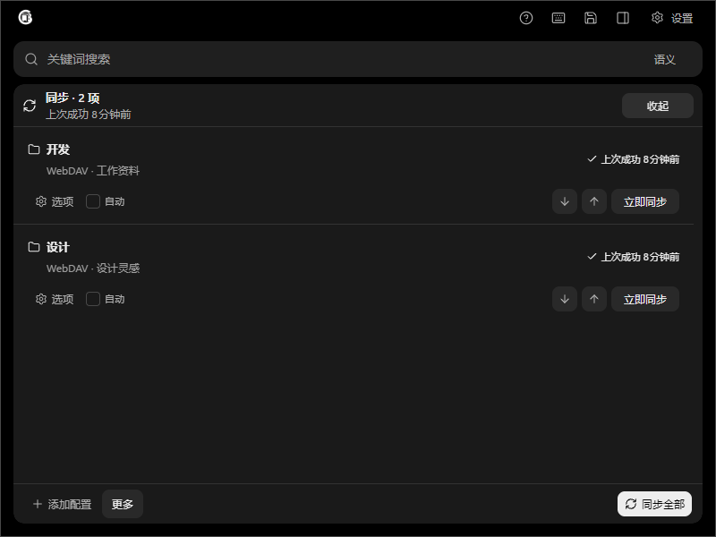
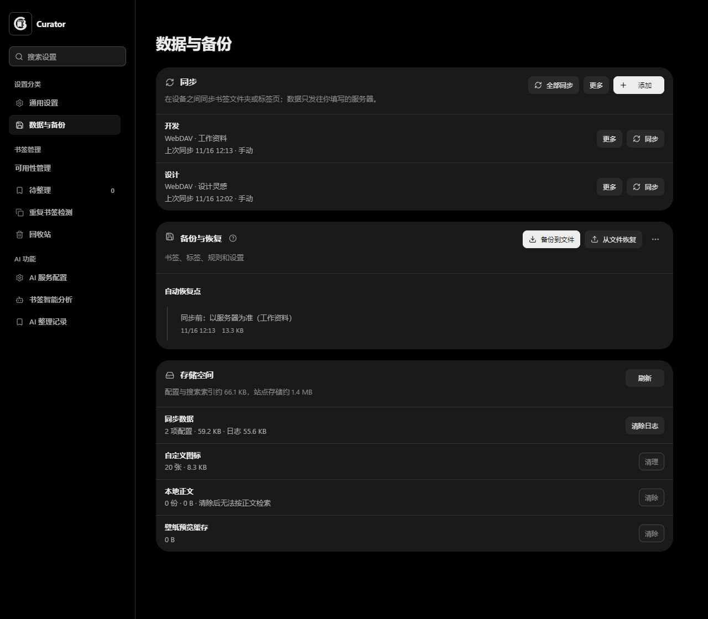

<p align="center">
  
</p>

<h1 align="center">Curator</h1>

<p align="center">
  <strong>收藏、找回、整理，在自己的设备之间同步。</strong><br>
  本地优先的 Chrome 书签工作区：快捷收藏与搜索、常驻侧栏、玻璃新标签页、安全清理、备份恢复和可选 AI。
</p>

<p align="center">
  
  
  
  
</p>

<p align="center">
  <strong>原生 Chrome 书签 · 无 Curator 账号或自有云端 · 无遥测 · AI 与同步按需配置</strong><br>
  <sub>支持 Chrome 116+，通过开发者模式加载。本文介绍当前仓库的实现；预编译包的功能以对应 Release 为准。</sub>
</p>

<p align="center">
  <a href="#快速开始">安装</a> ·
  <a href="#功能与界面">功能与界面</a> ·
  <a href="#搜索与快捷键">搜索与快捷键</a> ·
  <a href="#隐私与网络访问">隐私与网络访问</a> ·
  <a href="#开发与验证">开发与验证</a>
</p>

---

https://github.com/user-attachments/assets/54babc20-983f-42e3-bfc9-89510a9194aa

<p align="center">
  <sub>功能演示。下方截图来自当前构建，使用隔离的演示书签和同步服务。</sub>
</p>

## 功能与界面

Curator 直接读写浏览器的原生书签树。弹窗、侧栏、新标签页与 Chrome 书签管理器共享书签，改名、移动和删除会相互反映。标签、摘要、设置和缓存保存在扩展自己的本地存储中。

| 入口 | 可以做什么 |
| --- | --- |
| **工具栏弹窗 / 常驻侧栏** | 保存当前页、编辑和移动书签、文件夹筛选、拼音与组合搜索、智能分类、固定到新标签页、查看操作反馈和同步 |
| **新标签页** | 聚合多个文件夹、逐级浏览、拖拽与键盘排序、固定入口、本地与网页搜索、背景、玻璃材质、卡片和时钟设置 |
| **设置 → 书签管理** | 处理待整理、检测失效链接、查看检测历史、更新重定向网址、设置忽略规则、去重、恢复回收站条目 |
| **设置 → 数据与备份** | 配置多设备同步、导出与恢复备份、查看自动恢复点、管理标签数据和本地存储 |
| **设置 → AI 功能** | 配置服务与模型、测试连接、批量分析书签、审核建议、查看 AI 整理记录 |
| **弹窗 / 侧栏 → 存档当前页面** | 打开独立存档页，将已加载的网页保存为 MHTML 文件 |

设置页顶部的 **搜索设置** 可以直接定位“同步”“正文”“快捷键”“模型”等项目，支持 `Ctrl / ⌘ + K`。侧边导航按设置、书签管理和 AI 功能分组；窄屏通过导航面板切换，返回页面时保留阅读位置。

### 1. 弹窗与侧栏：收藏、搜索和就地整理

弹窗将搜索框、当前页操作区和书签列表放在同一个工作区。左侧浏览或筛选文件夹，右侧查看书签；侧栏沿用相同操作，并随宽度调整布局。

- **当前页操作**：未收藏时可直接保存、手动选目录或智能分类；已收藏时可编辑，并固定到新标签页或取消固定。
- **就地整理**：编辑标题和网址、移动、删除、调整书签顺序，不必先打开 Chrome 书签管理器。删除后可从反馈中撤销，也可以到回收站恢复。
- **搜索与范围**：支持标题、网址、文件夹路径、拼音首字母和全拼；已保存的标签、别名、摘要及正文索引也可参与检索。目录筛选支持键盘高亮和回车应用。
- **操作反馈区（灵动岛）**：当前页状态、保存、移动、删除与撤销在同一区域反馈；已配置同步后，这里也是同步工作区的入口。展开和收起同步时保留原书签列表、搜索词与滚动位置。
- **随手收集**：`Alt + Shift + I` 将当前页保存到“待整理”。后续是否调用 AI、生成建议或自动移动，由“通用设置 → 用快捷键保存到待整理后”决定。
- **常驻侧栏**：顶部“打开常驻书签侧栏”让搜索和整理面板留在浏览器侧边；切换网页时更新当前页信息，并保留搜索状态。

<p align="center">
  
</p>

顶部还提供 **键盘帮助、存档当前页面和设置**。侧栏读取当前页信息受浏览器权限约束；遇到未授权页面，可点击工具栏中的 Curator 图标，再操作当前页。已有书签的搜索与整理不依赖该站点授权。

### 2. 新标签页：书签、搜索与玻璃材质

新标签页由时钟、搜索栏、固定入口和所选文件夹组成。可直接添加书签、编辑标题与网址、替换图标、移动或删除；拖拽和键盘排序会更新原生书签顺序。

<p align="center">
  
</p>

右上角设置抽屉分为五组，调整会自动保存：

| 分组 | 当前可用设置 |
| --- | --- |
| **来源** | 搜索并选择多个文件夹；在“平铺书签”和“逐级浏览”间切换；显示或隐藏文件夹名、来源导航；调整来源顺序 |
| **外观** | 紧凑 / 均衡 / 宽松卡片密度；显示标题；自动适配或固定列数、页面宽度、垂直居中、标题行数；背景与时间日期 |
| **玻璃** | 均衡 / 清透 / 柔和预设；精细调整玻璃模糊、底色深浅、背景饱和度、背景亮度、边缘高光；实时预览、撤销本次调整和恢复默认值 |
| **搜索** | 显示搜索栏、默认网页引擎、快捷引擎、网页打开位置；紧凑 / 标准 / 宽松尺寸、宽度、位置和提示文字 |
| **高级设置** | 隐藏设置图标、新标签页打开书签、显示固定入口 |

**背景与时钟**

- 背景可选 **图片、视频、图片链接、纯色**。图片与视频从本机选择，图片链接使用你填写的地址。
- 图片、视频和图片链接可开启 **背景蒙版**，提供 **均匀暗化、柔和渐暗、轻磨砂** 三种样式，分别调节遮罩浓度和模糊。
- 玻璃材质应用于卡片、固定入口、时钟、搜索栏和设置面板，与背景蒙版分别调整。
- 时钟支持“时间和日期 / 仅时间 / 仅日期”，以及“单行 / 胶囊 / 卡片”样式；可设置时区、日期格式、秒数和 12 小时制，也可隐藏。
- 固定入口可从当前页或书签操作中添加，并通过拖拽排序；在高级设置中控制是否显示。

**搜索栏**

本地书签搜索与网页搜索共用输入框。选中书签后回车打开；未选中书签时，按当前引擎搜索网页。输入 `/` 可查看内置命令，例如打开设置。可选 AI 语义搜索使用与弹窗相同的服务配置。

内置 Google、Bing、百度、DuckDuckGo、Perplexity、ChatGPT、You.com、Kagi 和 Brave。`Ctrl / ⌘ + Enter` 可同时在已启用的前 **4** 个引擎中搜索。引擎设置只作用于 Curator 新标签页，不改变浏览器地址栏的默认搜索引擎。

### 3. 待整理、链接体检与安全清理

**待整理**

在“设置 → 待整理”查看快捷键收集的书签，按标题或网址搜索、选择已有文件夹，或接受新建目录建议。可移动、保留原位、重新分析，或撤销最近一次移动；地址已经变化时，旧建议不会继续应用。待办保留至处理，已完成的整理历史保留最近 200 条。

**可用性管理**

| 页面 | 操作 |
| --- | --- |
| **失效书签检测** | 选择全部书签或指定目录，设置并发数和超时，开始、暂停、继续或停止检测；按状态查看结果、处理选中项 |
| **检测历史** | 查看历次检测结果和处理状态，并按目录范围查看 |
| **网址更新** | 对照原网址与重定向目标，逐条或批量确认更新 |
| **忽略规则** | 按书签、域名或文件夹排除检测 |
| **重复书签检测** | 检测相同网址，选择保留规则，再确认清理副本 |
| **回收站** | 搜索、分页查看、恢复或永久移除条目；记录保留至主动清空 |

可用性检测会区分访问失败、需要复查和已确认的异常；网络超时、登录限制或站点拦截不应被当作可直接删除的证据。进度、长错误和批量选择有各自的位置，处理过程中保留已有结果。

去重保留 URL 中有意义的协议、端口、路径、参数和片段差异。可按推荐、最新、最早、最短路径、有标签、新标签页来源或最近访问选择保留项；每组至少留下一条书签。

Curator 的书签删除与清理入口会保存对应的回收站记录，包括关联标签和自定义图标。恢复点另用于批量整理与覆盖前的数据保护，见下方“备份与恢复”。

### 4. 多设备同步

在 **设置 → 数据与备份 → 同步 → 添加** 建立配置。每项配置连接一个本地书签文件夹，或所有普通窗口的标签页，与指定服务器位置对应。可同时管理多项配置，界面与后台共用 [floccus](https://github.com/floccusaddon/floccus) 同步引擎。

| 服务 | 远端形式 | Curator 内可选口令加密 |
| --- | --- | --- |
| WebDAV | XBEL / HTML 文件，支持常见服务商地址预设 | 支持 |
| Nextcloud Bookmarks | 服务器文件夹 | — |
| S3 兼容存储 | 存储桶中的 XBEL / HTML 文件，支持路径式访问 | 支持 |
| Git | 指定仓库、分支内的 XBEL / HTML 文件 | — |
| Linkwarden | 服务器集合；支持 2.17+ 的书签和文件夹排序 | — |
| Karakeep | 服务器列表 | — |
| Google Drive | 书签文件，通过 Google 登录授权 | 支持 |
| Dropbox | 书签文件，通过 Dropbox 登录授权 | 支持 |

**方向与自动触发**

- **双向合并**，或固定为 **只下载：服务器覆盖本机 / 只上传：本机覆盖服务器**。
- 可按书签或标签页变化、浏览器启动、定时间隔触发；也可选择“只检查，不自动同步”，并按需发送待同步通知。
- 新建配置默认启用变化后同步及每 15 分钟定时；这些选项可在保存前调整。
- 每项可单独同步、取消，也可全部同步；支持一次性下载、上传以及确认后的强制同步。覆盖本机书签前创建恢复点，同步与备份恢复互斥。
- 安全保护在单次大量新增或删除时停止运行，等待确认。正在收尾的同步仍会完成内部处理；同一配置随后接收的请求按顺序执行。
- Linkwarden 的新配置默认开启顺序同步；旧配置与未声明该选项的导入配置保持关闭，可在“高级”中开启。旧服务器继续同步书签内容。

**在弹窗与侧栏中同步**

配置完成后，点击当前页操作区末尾的同步入口。工作区内可查看每项的进度、上次成功时间、待处理更改与错误，并直接修改自动同步、编辑配置、下载一次或上传一次。进度到 100% 时仍可能显示“正在完成”，成功时间以后台实际结束为准。

底栏提供 **添加配置、更多、同步全部**。“更多”包含配置导入导出和同步日志；子页按 `Esc` 返回同步列表，再按一次回到书签。弹窗中发起 Google / Dropbox 登录会将未保存表单接续到设置页，完成授权后继续配置。

<p align="center">
  
</p>

**配置、权限与日志**

可导出单项或所选配置、导出某项的 HTML 书签，查看或下载日志、重置同步状态和删除配置。导入配置后需重新选择本机文件夹、完成授权，再开启自动同步。日志默认隐去书签、网址和账号；完整日志需要主动选择。

同步配置导出文件包含服务器密码或令牌，迁移时需妥善保管。同步范围是书签或标签页，**Curator 标签、AI 设置、规则和本地壁纸不会随书签自动同步**。

标签页模式包含普通窗口及标签组结构，不涉及隐身窗口；“服务器覆盖本机”可能关闭本机普通标签页，界面会单独确认。Nextcloud 的可选点击次数统计需要浏览历史权限。

Google Drive / Dropbox 的普通登录依赖安装包内的发行方 OAuth 配置。源码构建若没有配置对应客户端，会提示登录不可用；维护者参见 [发行方配置](src/vendor/floccus/OAUTH.md)。高级设置保留自定义 OAuth 客户端。

### 5. 备份与恢复、存储管理

“设置 → 数据与备份”按 **同步、备份与恢复、存储空间** 排列。备份区的主要操作是 **备份到文件** 和 **从文件恢复**；HTML 书签导出、标签数据导入导出与清空放在“更多”中。

<p align="center">
  
</p>

**备份包含什么**

| 数据 | 保存或迁移方式 |
| --- | --- |
| 原生书签树、标签、摘要、别名、整理规则、回收站、可恢复的偏好与新标签页设置、自定义图标 | Curator JSON 备份 |
| 跨浏览器通用书签 | “更多 → 导出 HTML 书签”，在目标浏览器的书签管理器中导入 |
| 标签、摘要和别名 | “更多 → 导出标签数据 / 导入标签数据” |
| 同步配置及其凭据 | 同步区域单独导出配置 |
| AI API Key、浏览器 Cookie | 不包含在 Curator 完整备份中；在目标设备重新配置或登录 |
| 网页正文索引、缓存 | 不包含在完整备份中；需要时重新建立 |
| 本地壁纸图片、视频，已下载的 MHTML | 单独保留原文件 |

**恢复流程**

1. 选择 JSON 文件，或点击一条自动恢复点，打开 **恢复预览**。
2. 查看内容和差异，在预览中搜索书签，确认本次可恢复的数据。
3. 点击 **恢复全部**，或在 **部分恢复** 中选择“书签与标签”“仅标签数据”“仅新标签页设置”。
4. 完成后关闭预览，原列表和阅读位置保持不变。

书签恢复采用增量补齐，将需要补回的内容放入恢复目录，保留现有书签；标签合并保护较新的手动数据。批量整理、恢复及以服务器为准的书签同步等受保护操作前会创建自动恢复点，默认保留最近 **5** 份。

**存储空间**

查看本地用量，按类别清理同步日志、闲置自定义图标、失效图标引用、本地正文和壁纸预览缓存。清除正文后，对应内容不再参与全文检索；清理日志和缓存不等于删除同步配置或原生书签。

### 6. 可选 AI：语义搜索、分类与批量分析

不配置 AI，也能使用书签搜索、编辑、侧栏、新标签页、链接检测、去重、同步、备份和 MHTML 存档。AI 由你选择的服务直接提供，可使用 API Key，也可连接允许免 Key 的本机服务。

**配置入口：设置 → AI 功能 → AI 服务配置**

- 填写服务地址、API Key 与模型，保存并测试连接。
- 从服务获取模型列表、搜索选择模型，或按行维护自定义模型 ID。
- 调整推理强度、接口类型与每批最大请求数；具体能力取决于所选模型及协议。
- “模型资料”展示可获得的模型能力、上下文和参考价格；可手动从 models.dev 更新，或开启每日自动更新。该更新只下载公开资料，不发送密钥、书签或自定义服务配置。

| 接口类型 | 用途 |
| --- | --- |
| 自动识别 | 根据服务地址与路径选择协议 |
| OpenAI Responses | Responses API 及兼容服务 |
| OpenAI Chat Completions | Chat Completions 兼容服务与本地推理服务 |
| Anthropic Messages | Messages API 及兼容服务 |
| Gemini GenerateContent | Gemini 原生生成接口 |
| Gemini Interactions | Gemini Interactions 接口 |

**使用方式**

| 场景 | 行为 |
| --- | --- |
| 搜索框中的“语义” | 在保留原文、站点、目录、时间和排除条件的基础上补充语义；失败时保留本地结果并说明原因 |
| 当前页“智能分类” | 分析当前网页，提出标题与保存位置；可选择推荐目录、新建目录或手动保存 |
| 设置 → 书签智能分析 | 按全部或指定范围批量生成标签、摘要、别名、标题和目录建议；支持暂停、继续、停止、筛选和批量审核 |
| 通用设置 → 自动分析 | 对新增书签自动分析，高置信时可改名和移动 |
| 设置 → AI 整理记录 | 回看自动分析结果及处理状态 |

**快捷键收藏后的策略独立设置**

“通用设置 → 用快捷键保存到待整理后”有四种方式：

1. 只保存，暂不分析。
2. 生成标签，高置信时自动移动。
3. 只生成标签和摘要，保留在待整理。
4. 生成整理建议，由我决定是否移动。

这项策略不受“自动分析”开关控制，分析失败时保留在待整理。手动批量建议需要审核；已启用的自动分析或自动移动则按所选策略执行。

**网页内容与本地索引**

“通用设置 → 网页内容索引”分别控制“保存网页内容索引”和“保存完整正文”。已经保存的内容可用于本地搜索；提取内容时仍需访问目标网页。**网页内容辅助解析** 是另一项独立开关，启用后可在 AI 分析时通过 Jina Reader 读取内容，该服务会收到目标网址。

### 7. MHTML 离线存档

在弹窗或侧栏点击 **存档当前页面**，进入独立的“网页离线存档”页：

1. 确认来源页面；提前展开或加载希望保留的内容，并保持来源标签页打开。
2. 点击 **保存离线文件**，首次使用时授予页面存档权限。
3. 浏览器将已加载的页面、图片和样式生成单个 `.mhtml` 文件，下载到本机。

页面支持重新读取来源、回到来源、重新保存和再次下载。MHTML 可用 Chrome 或 Edge 离线打开；脚本交互、流媒体和依赖服务器的功能无法离线运行。该操作不调用 AI，也不上传至 Curator 服务。

## 快速开始

需要 **Chrome 116+**。**v1.6.0** 汇总了本文介绍的同步、侧栏、备份恢复与界面更新。当前 README 随仓库维护；使用较早的预编译包时，请查看对应版本的发布说明。

### 从源码构建

建议使用 **Node.js 24** 与 npm：

```bash
git clone https://github.com/sy0u1ti/curator-bookmarks.git
cd curator-bookmarks
npm ci
npm run build
```

1. 在 Chrome 打开 `chrome://extensions/`。
2. 开启 **开发者模式**。
3. 点击 **加载已解压的扩展程序**，选择项目中的 `dist/`。
4. 将 Curator 固定到工具栏，打开弹窗；新建标签页即可进入 Curator 新标签页。

本地构建不要求配置 OAuth。需要提供 Google / Dropbox 登录时，复制 [oauth.env.example](oauth.env.example) 为 `.env.local`，按 [发行方配置](src/vendor/floccus/OAUTH.md) 填写客户端和扩展身份；`npm run build:release` 会检查必需配置并输出到 `release/dist/`。

### 使用预编译包

从 [Releases](https://github.com/sy0u1ti/curator-bookmarks/releases) 下载所需版本的 `curator-bookmarks-*.zip` 并解压。在扩展管理页加载 **直接包含 `manifest.json` 的文件夹**：按包的结构，可能是解压目录，也可能是其中的 `dist/`。

### 首次配置与更新

- **先开始使用**：原生书签会直接出现；在新标签页设置中选择来源文件夹。AI 和同步可以稍后配置。
- **快捷键**：到“设置 → 通用设置 → 快捷键”查看绑定，或打开 `chrome://extensions/shortcuts` 调整。
- **更新开发版**：重新构建后，在扩展管理页对原来的 Curator 点击一次“重新加载”，再重新打开页面。仅刷新设置页不会替换旧后台。
- **迁移安装**：扩展 ID 决定本地设置归属。以另一 ID 加载会产生独立存储，迁移前导出 JSON 备份及同步配置，另存本地媒体文件。

从未固定扩展 ID 的旧包升级到 **v1.6.0 发行包** 时，新包的固定身份可能使它成为独立安装。请先备份，在新安装中恢复设置并重新配置凭据，再按需停用旧安装；原生 Chrome 书签由浏览器保留。加载时应选择解压后直接包含 `manifest.json` 的目录。

Curator 会替换浏览器新标签页。停用扩展可恢复浏览器默认入口；原生书签仍由浏览器保留。

## 搜索与快捷键

### 本地搜索语法

| 输入 | 作用 |
| --- | --- |
| `react`、`shuqian`、`sq` | 按标题、网址和拼音全拼 / 首字母匹配 |
| `"not found"`、`"我爱我家"` | 查找原文短语，引号内不解释为操作符 |
| `site:github.com react` | 限定该域名及其子域名；支持 `domain:`、`站点:`、`域名:` |
| `url:/issues` | 限定网址包含的文本 |
| `folder:"前端资料"` | 限定文件夹路径；支持 `path:`、`文件夹:`、`目录:`、`路径:` |
| `type:文档` | 按已保存的内容类型筛选；支持 `kind:`、`类型:`、`类别:` |
| `最近2周`、`昨天`、`上个月` | 按书签添加时间筛选，支持中文数字与具体日期 |
| `sort:new react` | 按最近添加排序 |
| `-youtube`、`-"短视频"`、`排除 youtube` | 排除匹配项，包含已启用的正文检索字段 |

条件可以组合，例如 `site:github.com folder:"前端资料" 最近2周 -issue`。标签、摘要和正文搜索依赖本机已保存的数据；普通搜索本身不联网、不调用 AI。文件夹选择器按实际目录及子目录限定范围，`folder:` 则按路径文字匹配。

### 浏览器快捷键

| 快捷键 | 操作 |
| --- | --- |
| `Alt + Shift + S` | 打开弹窗并聚焦搜索 |
| `Alt + Shift + I` | 保存当前页到待整理，按所选策略处理 |
| `Alt + Shift + F` | 打开弹窗并启动智能分类，需要 AI 配置 |
| 自行分配 | 启用或停用书签自动分析 |

快捷键冲突时，可在 `chrome://extensions/shortcuts` 修改。

### 弹窗与侧栏

| 按键 | 操作 |
| --- | --- |
| `Ctrl / ⌘ + K`，或输入框外 `/` | 聚焦主搜索 |
| `Ctrl / ⌘ + F` | 聚焦文件夹筛选 |
| 主搜索为空时 `←` | 进入文件夹筛选 |
| 空文件夹筛选框中 `↑ / ↓` | 返回主搜索 / 进入文件夹树 |
| 文件夹筛选有输入时 `↑ / ↓`、`Enter` | 移动高亮、应用文件夹，保留输入操作 |
| 目录树与书签中 `↑ / ↓`、`← / →` | 上下选择，或在目录与书签间移动焦点 |
| `Enter` | 在前台新标签页打开书签 |
| `Ctrl / ⌘ + Enter` | 在后台新标签页打开并保留面板 |
| `Alt + Enter` | 在当前网页标签页打开 |
| `F2` | 编辑选中书签的标题和网址 |
| `Esc` | 逐层返回；输入框内先清空，同步子页先返回列表 |
| `Ctrl / ⌘ + /`，或输入框外 `?` | 打开键盘帮助 |

### 新标签页与设置

| 场景 | 按键与操作 |
| --- | --- |
| 新标签页搜索 | `↑ / ↓` 选择建议，`Enter` 打开；`/` 查看命令 |
| 新标签页网页搜索 | `Ctrl / ⌘ + Enter` 同时搜索前 4 个已启用引擎 |
| 新标签页书签排序 | 聚焦书签后 `Alt + 方向键` 调整顺序；`Alt + Shift + ← / →` 移到相邻来源文件夹 |
| 设置页 | `Ctrl / ⌘ + K` 搜索并定位设置 |

界面保留键盘焦点、输入法组合输入与系统减少动态效果支持。“通用设置 → 输入框 → 动态输入光标”控制所有输入框的光标效果，关闭后使用系统光标。

## 隐私与网络访问

Curator 没有账号体系、自有后端或遥测。原生书签保存在浏览器中，扩展附加数据使用 `chrome.storage.local`、IndexedDB 等本地存储；同步服务器、AI 服务与远程背景由你选择。

本地书签检索、编辑和读取已保存的正文可以离线进行。链接检测、网页内容提取、云端 AI 和远端同步需要网络；已经启用的自动任务也会按配置在后台访问相应服务。

| 场景 | 访问对象与数据 |
| --- | --- |
| 链接检测、重定向检查、网页内容提取 | 对应书签站点，依照授予的站点权限执行 |
| 自动或手动 AI 分析、AI 语义搜索 | 你配置的服务；根据任务发送查询、相关书签、网页内容或目录信息 |
| 网页内容辅助解析 | Jina Reader 接收需要解析的目标网址 |
| 新标签页站点图标 | 优先使用浏览器图标库；缺失时可能请求目标站点的图标并缓存 |
| 网页搜索 | 跳转到选定搜索引擎；多引擎搜索会将查询分别发给所选服务 |
| 图片链接背景 | 访问填写的图片地址 |
| 手动、定时、启动或变化后同步 | 配置的服务器或 Google Drive / Dropbox；登录时访问相应授权服务 |
| 模型资料更新 | 从 models.dev 下载公开资料，手动触发或按已开启的每日计划执行 |
| MHTML 存档 | 由浏览器捕获已加载内容并下载到本机，不上传至 Curator |

Manifest 的固定 `host_permissions` 为空，HTTP / HTTPS 站点访问列为可选权限。权限声明本身不会上传书签；授权后，相应手动或自动功能才可使用它。

| 权限 | 用途 |
| --- | --- |
| `bookmarks` | 读取与修改原生书签 |
| `storage`、`unlimitedStorage` | 保存设置、标签、索引、媒体及缓存 |
| `activeTab`、`sidePanel`、`favicon` | 当前页操作、常驻侧栏与站点图标 |
| `alarms`、`notifications` | 后台调度与操作 / 待同步通知 |
| `webNavigation`、`webRequest`、`declarativeNetRequest` | 导航状态、链接检测与网络请求协调 |
| 可选 `pageCapture` | 生成 MHTML |
| 可选 `tabs`、`tabGroups` | 同步普通窗口的标签页与标签组 |
| 可选 `identity` | Google / Dropbox 登录 |
| 可选 `history` | Nextcloud 点击次数统计 |

## 开发与验证

技术栈：**React 19、TypeScript、Vite / CRXJS、Base UI、Tailwind CSS v4、lucide-react**。扩展使用 Manifest V3；共享组件位于 `src/ui`，设计 token 位于 `src/styles/tokens.css`。

| 目录 | 职责 |
| --- | --- |
| `src/popup` / `src/sidepanel` | 紧凑书签工作区与当前页操作 |
| `src/newtab` | 新标签页、背景、玻璃材质、搜索与布局 |
| `src/options` | 设置、检测、批量分析与数据管理 |
| `src/archive` | MHTML 存档页 |
| `src/service-worker` | 消息、后台任务与同步协调 |
| `src/shared` | 搜索、存储、备份、AI 与同步契约 |
| `src/vendor/floccus` | 同步引擎、服务适配器及 Curator 接入层 |

```bash
npm run dev                 # 开发模式
npm run typecheck           # 类型与模块边界
npm test                    # 单元测试和结构回归，不启动浏览器
npm run build               # 开发安装包 → dist/
npm run build:release       # 校验发行方配置 → release/dist/
```

浏览器验证优先使用 **Ego / ego-browser**，在代理专用工作区和隔离 QA 数据中运行。下列脚本会先构建，再进行相应检查：

```bash
npm run test:sync-browser              # 同步服务、格式、方向、触发与保护机制
npm run test:sync-ui-browser           # 设置页同步界面
npm run test:popup-sync-browser        # 弹窗 / 侧栏同步工作区与登录表单接续
npm run test:sync-background-browser   # MV3 后台、协议、备份恢复与后台版本检查
npm run test:layout-stability-browser  # 1440 / 768 / 390px 布局与交互状态
```

`test:sync-modes-browser` 与 `test:sync-browser` 使用同一入口；`test:sync-protocols-browser` 只运行协议方向矩阵。可以限制同步检查范围，或复用专用 Ego 工作区：

```bash
npm run test:sync-modes-browser -- --adapters webdav --sections matrix
npm run test:layout-stability-browser -- --space <ego-space-id>
```

同步测试使用复制的 QA 扩展与隔离的书签、标签页数据，真实运行 MV3 worker、消息、存储和锁；远端服务由本地协议夹具提供。Google / Dropbox 的真实登录、取消、令牌刷新和同步仍需使用发行方测试账号验证。

仓库还保留 `smoke:extension`、`test:visual-browser` 等 Playwright / Chromium 回归脚本。它们使用独立浏览器；在本项目的代理工作流中，先使用 Ego，只有确认不可用或用户指定其他浏览器后才采用替代路径。`CURATOR_HEADLESS=1` 用于支持该变量的 Chromium 脚本，不控制 Ego 工作区。

`build` 会清空 `dist/`，不要同时运行多个构建，也不要在浏览器检查读取 `dist/` 时重新构建。真实工具栏弹窗有 Chrome 的自动尺寸行为，普通标签页预览不能完全替代；验证时不要重载用户正在使用的扩展或修改用户书签。

## 常见问题

<details>
<summary><strong>停用或卸载后，哪些数据还在？</strong></summary>

当前的原生书签仍在 Chrome 中，已经通过 Curator 完成的改名、移动或删除也仍然有效。标签、设置、索引和同步凭据属于扩展存储，卸载前应按需备份；本机下载的 MHTML 和导出文件另行保留。

</details>

<details>
<summary><strong>不配置 AI，或者不配置同步，可以使用吗？</strong></summary>

可以。两者都按需启用。搜索、编辑、侧栏、新标签页、清理、备份与 MHTML 不依赖 AI；同步只在建立服务配置后使用。链接检测和网页内容提取本身需要访问目标网页。

</details>

<details>
<summary><strong>书签同步能代替完整备份吗？</strong></summary>

同步让多个位置持续反映书签或标签页的变化，删除也可能传播；备份用于保留某个时间点的数据。Curator 的标签、规则、设置等不会随书签同步，需要 JSON 备份。同步配置及凭据又需单独导出，本地壁纸和 MHTML 文件单独保留。

</details>

<details>
<summary><strong>为什么 Google / Dropbox 提示安装包尚未配置登录？</strong></summary>

该构建未带对应发行方 OAuth 客户端，或安装身份与客户端回调不匹配。使用完成发行方配置的构建，或按同步编辑器高级设置配置自己的客户端。普通的 `npm run build` 可以在没有发行方配置时成功，其他本地功能仍可使用。

</details>

<details>
<summary><strong>为什么重新构建后，设置页提示后台仍是旧版本？</strong></summary>

Chrome 仍在运行先前加载的后台。进入 `chrome://extensions/`，对原来的 Curator 点击“重新加载”，再重新打开扩展页面。修改构建文件或单独刷新网页不会替换正在运行的后台。

</details>

<details>
<summary><strong>为什么安装 Release 后看不到 README 中的一些功能？</strong></summary>

README 跟随当前仓库代码更新，公开 Release 可能尚未包含后续提交。查看所安装版本的发布说明，或按“从源码构建”安装当前代码；迁移前先保存扩展附加数据。

</details>

## 反馈与许可

问题和建议请提交到 [GitHub Issues](https://github.com/sy0u1ti/curator-bookmarks/issues)，附复现步骤、Chrome 版本及错误信息。涉及同步时优先附匿名日志，无需提供真实书签库、密码或密钥。

主项目使用 [MIT](LICENSE)。

新标签页 GlassSurface 衍生自 React Bits，适用随附的 [MIT + Commons Clause 许可证](src/vendor/react-bits/LICENSE.md)。

书签同步使用 floccus。`src/vendor/floccus` 下的全部文件，包括 Curator 适配代码，适用 [Mozilla Public License 2.0](src/vendor/floccus/LICENSE.txt)；上游版本、来源与接入说明见 [floccus README](src/vendor/floccus/README.md)。构建产物包含相应的第三方许可文件。
