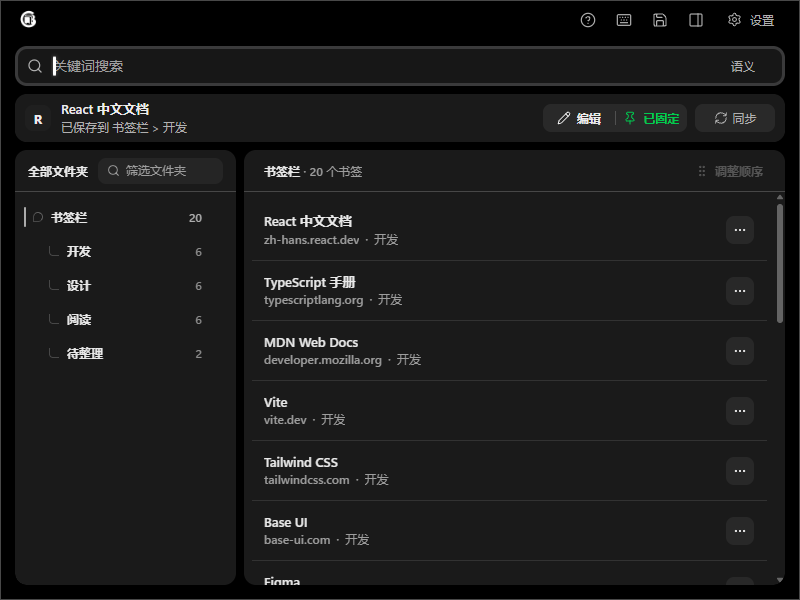
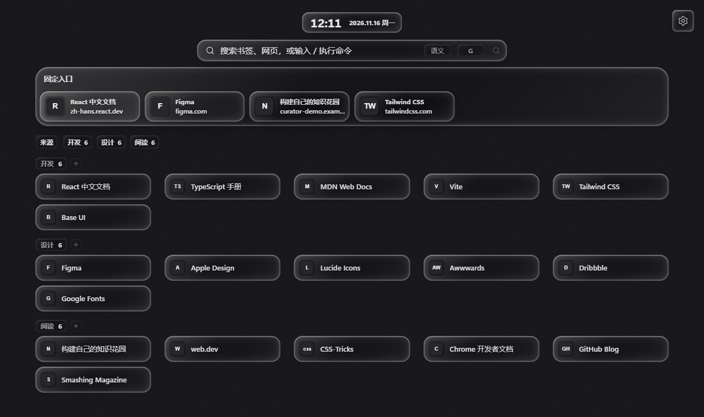

<p align="center">
  
</p>

<h1 align="center">Curator</h1>

<p align="center">
  <strong>让收藏，回到日常。</strong><br>
  本地优先的 Chrome 书签工作区，直接使用你已有的书签。
</p>

<p align="center">
  
  
  
</p>

<p align="center">
  <a href="#功能与界面">功能</a> ·
  <a href="#快速开始">安装</a> ·
  <a href="#搜索与快捷键">搜索与快捷键</a> ·
  <a href="#隐私与网络访问">隐私</a> ·
  <a href="#开发与验证">开发</a>
</p>

---

https://github.com/user-attachments/assets/bc6c5a9b-81f3-4d29-85da-30e031a6f9ca

## 功能与界面

### 收下网页，继续手头的事

看到值得留下的内容，按 `Alt + Shift + I` 放进“待整理”，或在弹窗里选好目录再保存。标题、网址和位置都能就地修改；打开常驻侧栏，切换网页时也能继续搜索和整理。

找回资料时，只记得一个词、一段拼音或所在目录就可以开始搜索。已保存的标签、摘要和正文也能成为线索，普通搜索完全在本机完成。

<p align="center">
  
</p>

### 让常用资料留在眼前

把常用文件夹和固定入口放在新标签页，拖拽排好顺序。搜索栏既能找本地书签，也能搜索网页；背景、玻璃材质、卡片密度和时钟可以按自己的习惯调整。

弹窗、侧栏和新标签页共享 Chrome 的原生书签。在哪一处改名、移动或删除，其他入口都会反映出来。

<p align="center">
  
</p>

### 整理积累，也留好退路

去重、检查失效链接、确认重定向后的新网址，让旧收藏重新可用。检测结果供你判断：超时、登录限制或站点拦截可能只是暂时无法访问。去重时每组至少保留一条，通过 Curator 删除的书签可从回收站恢复。

需要帮手时，可以在 **设置 → AI 功能** 接入自己的服务或本机模型，生成标签、摘要和分类建议，也可启用语义搜索。批量建议经审核后应用；自动分析、改名和移动按你选择的策略执行。

**设置 → 数据与备份** 可以导出 JSON 备份，或从文件、自动恢复点中预览并恢复数据。书签恢复会补回缺失内容，保留现有书签；受保护的批量整理和覆盖操作前会创建恢复点，默认保留最近 5 份。

<p align="center">
  
</p>

### 换一台设备，接着用

在 **设置 → 数据与备份 → 同步** 连接自己的存储服务：WebDAV、Nextcloud Bookmarks、S3、Git、Linkwarden、Karakeep、Google Drive 或 Dropbox。每项配置对应一个书签文件夹或普通窗口的标签页，可以双向合并，也可以指定上传、下载方向。

配置好后，从弹窗或侧栏就能查看进度、手动同步或调整自动同步。大量新增或删除会触发保护，等待确认；从服务器覆盖本机标签页可能关闭现有普通标签页，会另行确认。

<p align="center">
  
</p>

同步会传播书签的修改与删除。扩展的标签、设置和本地媒体不随书签同步，迁移方式见[更新与迁移](#更新与迁移)。

如果需要留住网页本身，在弹窗或侧栏选择 **存档当前页面**，将已加载的文字、图片和样式保存为一个 MHTML 文件。保存前展开所需内容并保持来源页打开；文件可用 Chrome 或 Edge 离线阅读，流媒体和依赖服务器的功能无法离线运行。

## 快速开始

需要 **Chrome 116+**。Curator 会接管新标签页，已有书签无需导入。

1. 从 [Releases](https://github.com/sy0u1ti/curator-bookmarks/releases) 下载 `curator-bookmarks-*.zip` 并解压。
2. 打开 `chrome://extensions/`，开启 **开发者模式**。
3. 点击 **加载已解压的扩展程序**，选择直接包含 `manifest.json` 的文件夹。
4. 将 Curator 固定到工具栏，在新标签页设置中选好来源文件夹，即可开始使用。

### 从源码构建

使用 Node.js 24 与 npm：

```bash
git clone https://github.com/sy0u1ti/curator-bookmarks.git
cd curator-bookmarks
npm ci
npm run build
```

按上述步骤加载生成的 `dist/`。普通构建不要求 OAuth 配置；Google / Dropbox 登录需要发行方客户端，配置方法见 [OAUTH.md](src/vendor/floccus/OAUTH.md)，也可在同步高级设置中填写自己的客户端。

### 更新与迁移

更新文件或重新构建后，在扩展管理页对原来的 Curator 点击 **重新加载**，再打开扩展页面。

扩展 ID 改变时会成为独立安装，卸载也会移除扩展的本地数据。迁移前导出 JSON 备份和同步配置：

- **JSON 备份**：书签、标签、摘要、别名、规则、回收站、可恢复的设置和自定义图标。
- **同步配置**：单独导出，包含密码或令牌；导入后需重新选择本机文件夹、完成授权并启用同步。
- **另行保留**：本地壁纸、视频和 MHTML 文件。AI API Key 需要重新配置；Cookie、正文索引和缓存不在备份中。

停用 Curator 后可恢复浏览器默认新标签页，原生书签仍由 Chrome 保留；此前对书签的改动也会保留。

## 搜索与快捷键

| 输入 | 用法 |
| --- | --- |
| `react`、`shuqian`、`sq` | 关键词、中文拼音全拼或首字母 |
| `"not found"` | 原文短语 |
| `site:github.com`、`url:/issues` | 限定站点或网址片段 |
| `folder:"前端资料"` | 按文件夹路径查找 |
| `type:文档` | 筛选已保存的内容类型 |
| `最近2周`、`昨天`、`上个月` | 按添加时间筛选 |
| `sort:new` | 最近添加的排在前面 |
| `-youtube`、`-"短视频"` | 排除匹配项 |

条件可以组合：`site:github.com folder:"前端资料" 最近2周 -issue`。标签、摘要和正文检索依赖本机已保存的数据。

| 快捷键 | 操作 |
| --- | --- |
| `Alt + Shift + S` | 打开弹窗并聚焦搜索 |
| `Alt + Shift + I` | 保存当前页到待整理 |
| `Alt + Shift + F` | 智能分类，需要 AI 配置 |
| `Ctrl / ⌘ + K` | 在弹窗、侧栏中聚焦搜索；在设置页搜索设置 |
| `F2` | 在弹窗或侧栏编辑选中的书签 |
| `Esc` | 清空当前输入或逐层返回 |
| `Ctrl / ⌘ + /` | 在弹窗或侧栏打开完整键盘帮助 |

浏览器快捷键可在 `chrome://extensions/shortcuts` 修改。快捷键收藏后的分析与移动策略，在 **通用设置 → 用快捷键保存到待整理后** 单独设置。

## 隐私与网络访问

Curator 没有账号体系、自有后端或遥测。原生书签保存在浏览器中，标签、设置、索引等附加数据留在本机。普通搜索和编辑可以离线进行；联网功能直接访问对应站点或你选择的服务。

完整的数据处理、权限和外部服务说明见[隐私政策](PRIVACY.md)。

| 功能 | 发送或获取的数据 |
| --- | --- |
| 链接检测、正文提取、站点图标 | 访问对应书签站点；图标优先使用浏览器缓存 |
| AI 分析与语义搜索 | 向所配置的服务发送查询、相关书签、网页内容或目录信息 |
| 网页内容辅助解析 | 启用后，Jina Reader 会收到目标网址 |
| 同步 | 向所配置的服务器传输书签或普通窗口的标签页；登录时访问相应授权服务 |
| 网页搜索、远程背景 | 向所选引擎发送查询，或访问你填写的图片地址 |
| 模型资料更新 | 从 models.dev 下载公开资料，不发送密钥或书签 |

自动分析、同步和模型资料更新按已启用的配置在后台运行。MHTML 存档由浏览器在本机生成。

站点访问为可选授权；页面存档、标签页同步、Google / Dropbox 登录和 Nextcloud 点击统计也会按需申请权限。完整声明见 [manifest.json](src/manifest.json)。

## 开发与验证

基于 React 19、TypeScript、Vite / CRXJS、Base UI 和 Tailwind CSS v4。

```bash
npm run dev                          # 开发模式
npm run typecheck                    # 类型与模块边界
npm test                             # 单元测试与结构回归
npm run test:sync-browser             # 同步回归
npm run test:layout-stability-browser # 布局与交互回归
npm run build:release                # 校验 OAuth 配置并构建到 release/dist/
```

上述浏览器测试使用 Ego 和隔离数据，并自动构建。构建会清空 `dist/`，请串行执行构建与浏览器测试。完整命令见 [package.json](package.json)。

## 反馈与许可

问题和建议请提交到 [GitHub Issues](https://github.com/sy0u1ti/curator-bookmarks/issues)，附复现步骤、Chrome 版本和错误信息。同步问题可附匿名日志，请勿提交书签库、密码或密钥。

主项目使用 [MIT](LICENSE)。新标签页 GlassSurface 衍生自 React Bits，适用 [MIT + Commons Clause](src/vendor/react-bits/LICENSE.md)。

同步使用 floccus。`src/vendor/floccus` 下的文件（含 Curator 适配代码）适用 [MPL 2.0](src/vendor/floccus/LICENSE.txt)，上游来源见 [floccus README](src/vendor/floccus/README.md)。
